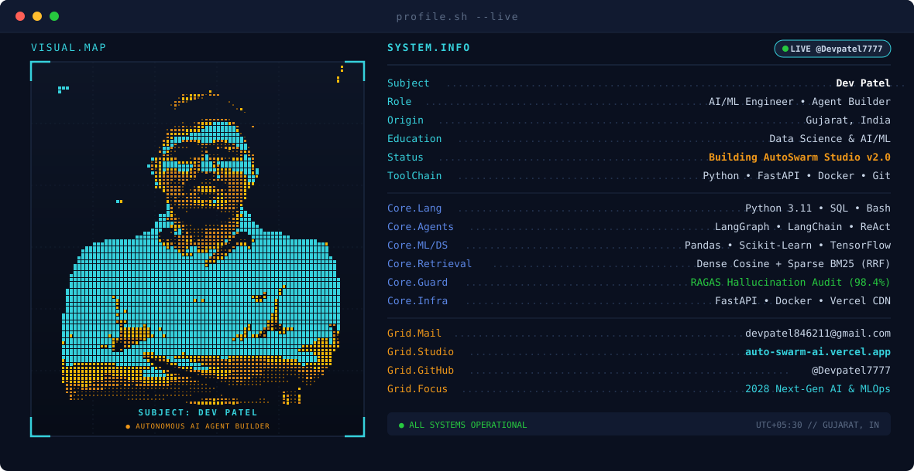

<div align="center">

<picture>
  <source media="(prefers-color-scheme: dark)" srcset="./assets/dark.svg" />
  <source media="(prefers-color-scheme: light)" srcset="./assets/light.svg" />
  
</picture>

</div>

<br/>

<div align="center">
  
</div>


<p align="center">
  <a href="https://dev-7-patel-portfolio.vercel.app/"></a>
  &nbsp;
  <a href="https://linkedin.com/in/dev-patel-0a1291216"></a>
  &nbsp;
  <a href="mailto:devpatel846211@gmail.com"></a>
  &nbsp;
  <a href="https://dev-7-patel-portfolio.vercel.app/#contact"></a>
</p>

---

###  Executive Telemetry // About Me

```yaml
Analyst: Dev Patel
Specialization: Data Analytics, Predictive Machine Learning, Relational SQL, BI Architecture
Education: Data Science & AI/ML Training (IIT Delhi Rendezvous & Red and White Skill Education)
Location: Gujarat, India
Status: Open for Data Analyst, Business Intelligence, Python/SQL & AI/ML Roles
Portfolio: https://dev-7-patel-portfolio.vercel.app/
Contact: devpatel846211@gmail.com | +91 93289 77322
```

- 📊 **Data Analytics & BI**: Processing 10,000+ transactional records, designing star-schema data models, and authoring dynamic DAX measures for executive Power BI dashboards.
- 🧠 **Machine Learning & AI**: Building end-to-end predictive pipelines with Scikit-learn and XGBoost for classification, regression, and real-time Streamlit web deployment.
- 🗄️ **Relational SQL Architecture**: Architecting normalized 3NF schemas in MySQL & PostgreSQL, writing high-performance multi-table joins, CTEs, and window functions.
- 🤖 **Generative AI & Agentic Systems**: Implementing grounded Multi-PDF RAG engines with Gemini API and autonomous tool-calling agents using Groq LLMs & Serper API.


###  Flagship Showcase // Live Interactive Portfolio

<table>
<tr>
<td width="100%">

### 🌐 [Dev Patel — Cyber HUD Data & AI Portfolio](https://dev-7-patel-portfolio.vercel.app/)

A production-grade, cyberpunk-inspired interactive developer portfolio engineered with **zero external heavyweight UI dependencies**. Features real-time SVG Git commit DAG branch visualization, interactive 52-week telemetry matrix, Web Audio sound synthesis, terminal emulator (`Dev Patel OS`), and live metric counters.

<br/>


<br/>

👉 **[🚀 Launch Live Cyber Portfolio Website](https://dev-7-patel-portfolio.vercel.app/)** &nbsp;&bull;&nbsp; 📦 **[Explore Portfolio Source Code](https://github.com/Devpatel7777/portfolio)**

</td>
</tr>
</table>


###  Featured Public Repositories

| Repository | Domain | Core Stack | Key Engineering Highlights | Source |
| :--- | :---: | :---: | :--- | :---: |
| **[power-bi-final](https://github.com/Devpatel7777/power-bi-final)** | Business Intelligence | `Power BI` `DAX` `Data Modeling` | Interactive sales analytics reporting over 10,000+ sales records across 4 categories and 8 core business KPIs. | [Explore ↗](https://github.com/Devpatel7777/power-bi-final) |
| **[ecommerce-sql-analysis](https://github.com/Devpatel7777/ecommerce-sql-analysis)** | SQL Architecture | `MySQL` `Relational DB` `CTEs` | 6-table normalized 3NF schema, 15+ complex analytical queries with window functions and customer cohort segmentation. | [Explore ↗](https://github.com/Devpatel7777/ecommerce-sql-analysis) |
| **[ML-Crop-Recommendation](https://github.com/Devpatel7777/ML-Crop-Recommendation)** | Machine Learning | `Python` `Scikit-learn` `Streamlit` | Multi-class ML classification predicting 22 crop types from 7 soil and weather features with real-time field data input. | [Explore ↗](https://github.com/Devpatel7777/ML-Crop-Recommendation) |
| **[Gen_AI](https://github.com/Devpatel7777/Gen_AI)** | Generative AI | `LangChain` `Gemini API` `RAG` | Multi-PDF RAG assistant with Gemini embeddings and vector retrieval for 100% grounded document QA and exam prep. | [Explore ↗](https://github.com/Devpatel7777/Gen_AI) |
| **[AI-Travel-Planner](https://github.com/Devpatel7777/AI-Travel-Planner)** | Autonomous Agents | `Groq LLM` `Serper API` `LangChain` | Autonomous tool-calling agent orchestrating real-time web search for flight, budget, and live weather telemetry. | [Explore ↗](https://github.com/Devpatel7777/AI-Travel-Planner) |
| **[Prodigy-InfoTech](https://github.com/Devpatel7777/Prodigy-InfoTech)** | Data Science | `Pandas` `NumPy` `Matplotlib` `EDA` | Comprehensive exploratory data analysis across 500k+ records, outlier treatment, and demographic correlation models. | [Explore ↗](https://github.com/Devpatel7777/Prodigy-InfoTech) |

<p align="center">
  <a href="https://github.com/Devpatel7777?tab=repositories">
    
  </a>
</p>


###  Technical Arsenal &amp; Ecosystem

<div align="center">
  
</div>

<br/>

<div align="center">

| Category | Verified Technologies &amp; Tools |
| :--- | :--- |
| **Programming &amp; Scripting** | `Python (Pandas, NumPy)` &bull; `SQL (MySQL, PostgreSQL)` &bull; `JavaScript` &bull; `HTML5 / CSS3` &bull; `Bash` |
| **Data Analytics &amp; BI** | `Power BI (DAX, Power Query)` &bull; `Advanced Excel (Pivot, VLOOKUP)` &bull; `Matplotlib` &bull; `Seaborn` &bull; `EDA` |
| **Machine Learning &amp; AI** | `Scikit-learn` &bull; `XGBoost` &bull; `Supervised Learning` &bull; `Model Evaluation` &bull; `Streamlit` |
| **Generative AI &amp; LLMs** | `LangChain` &bull; `Google Gemini API` &bull; `Groq API` &bull; `RAG Pipelines` &bull; `Serper Search API` |
| **Databases &amp; Tools** | `MySQL Workbench` &bull; `PostgreSQL` &bull; `Git &amp; GitHub` &bull; `VS Code` &bull; `Jupyter Notebook` &bull; `Vercel` |

</div>


###  GitHub Telemetry &amp; Statistics

<div align="center">

<!-- Streak Stats -->
<picture>
  
</picture>

<br/><br/>

<!-- Stats and top langs grid -->


<br/><br/>

<!-- Followers and Profile Views badges -->

&nbsp;&nbsp;


</div>


###  Contribution Activity Grid Snake

<div align="center">

<picture>
  <source media="(prefers-color-scheme: dark)" srcset="https://raw.githubusercontent.com/Devpatel7777/Devpatel7777/output/github-contribution-grid-snake-dark.svg?v=1" />
  <source media="(prefers-color-scheme: light)" srcset="https://raw.githubusercontent.com/Devpatel7777/Devpatel7777/output/github-contribution-grid-snake.svg?v=1" />
  
</picture>

</div>


###  Contact &amp; Connect

<div align="center">

<a href="https://linkedin.com/in/dev-patel-0a1291216">
  
</a>
&nbsp;&nbsp;
<a href="mailto:devpatel846211@gmail.com">
  
</a>
&nbsp;&nbsp;
<a href="https://dev-7-patel-portfolio.vercel.app/">
  
</a>
&nbsp;&nbsp;
<a href="tel:+919328977322">
  
</a>

<br/><br/>

<p align="center"><sub>Designed with precision. Open for high-impact analytical engineering and machine learning roles.</sub></p>

</div>

<br/>


